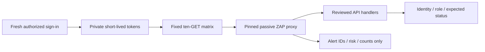

# Authenticated Web and API Security with OWASP ZAP

> This project is now part of **[Layered Security Testing for an Azure Platform](https://github.com/truthofsource/azure-devsecops-security-scanning)**, which combines Trivy, Checkov, TruffleHog and OWASP ZAP. This repository remains available for existing links and its original evidence.

**Check what users can reach after sign-in, including what lower-access accounts must be denied.**

[Business problem](#the-business-problem) · [Solution](#the-solution) · [Strengths](#engineering-strengths) · [Proof](#proof-it-works) · [Commands](docs/COMMANDS.md) · [Step by step](#step-by-step)


## The Business Problem

Different people use the same platform for different work: caregivers submit their records, while HR and administrators review protected employee information. A scan that reaches only the public sign-in page cannot show whether those boundaries still hold after a user signs in.

A page that hides a staff button may still leave its server route reachable by another role. Testing that behavior against sensitive records or using write actions can create operational risk, and saved access tokens or private responses can make a security report sensitive in its own right.

The business need was a controlled way to observe selected signed-in requests, confirm expected access and denials and retain useful findings without exposing employee information or changing business records.

## The Solution

Use OWASP ZAP to inspect a small, fixed set of read-only web requests. Confirm the signed-in accounts and roles, compare the expected allowed and denied responses, and report only safe summary information. This test observes traffic without sending active attack requests.

**Business outcome:** The recorded test covered ten read-only requests across four server handlers. It found two informational cache observations and no Low, Medium or High alerts in that limited sample; it did not clear the whole application.

## Tools Used and What They Do

| Tool or service | What it does | Where it fits |
| --- | --- | --- |
| OWASP ZAP | Observe the selected web/API requests for runtime security issues. | Actual DAST tool; passive, active and authenticated modes have different scopes. |
| Playwright and Chromium | Prepare/check browser sessions and protected viewer behavior. | Platform acceptance tooling; the local viewer does not sign into Entra. |
| Microsoft Entra ID | Supply the Admin and Caregiver identities compared in access checks. | Actual authentication boundary; no credentials or reusable sessions are included. |
| Python and GitHub Actions | Exercise the bounded request/report contract with fictional responses. | Public validation is local/manual-only, not a live authenticated scan. |

This retained tool project remains linked from the combined security-scanning portfolio entry. Historical scanner results keep their original target, date and coverage limits.

## Step by Step

A short walkthrough of the process, with technical instructions and evidence limits in the sections below.

1. **Prepare the approved test accounts (Entra test identities)** — Use authorized users with different access levels for the selected test. Keep their sign-in information and private responses out of public reports.

2. **Send the selected requests (OWASP ZAP)** — The test sends a fixed set of read-only website and server requests through ZAP. This setup observes the traffic without sending active attack requests.

3. **Compare allowed and denied access** — Check whether each account receives the expected response. A lower-access user must not gain permission merely because the page is reachable.

4. **Review the limited results** — Save safe summary information and investigate unexpected behavior. The recorded sample does not establish security coverage for every page or action.

## Engineering Strengths

| Strength | Practical value |
| --- | --- |
| **HTTP behavior** | Check how the website and server actually respond, including details that software-package and infrastructure scans cannot see. |
| **Authenticated coverage** | Check selected pages or server actions after sign-in, then compare allowed users with users who should be denied. |
| **Controlled passive testing** | Inspect selected web traffic without sending attack requests. Check the expected permissions and publish only safe summaries. |

## Architecture



This project is derived from actual workforce-platform implementation. Identifying labels/targets use examples. The local viewer and demonstration are new reference code; [source mapping](docs/SOURCE-MAP.md) identifies the copied/extracted files and limitations.

## What Was Built

| Component | Purpose | Implementation |
| --- | --- | --- |
| Actual authenticated adapter | Fixed target, private token handling and alert-summary filtering | [Source](scripts/zap_authenticated.py) |
| Actual role matrix | Four allowlisted handlers and expected actor/status observations | [Source](scripts/zap_role_matrix.py) |
| Pinned ZAP image | A scanner build identified by its exact fingerprint | [Pin](security/zap-lock.json) |
| Actual tests | Reject wrong identity, incorrectly structured roles, arbitrary routes and token/report leakage | [Tests](scripts/) |
| Local demonstration | Exercise actual rule/evaluation code using fictional data | [Demo](scripts/demo.py) |
| Dated context | Keep earlier platform results separate from the new local example | [Context](data/history.json) |

## Proof It Works

### 1. Run focused checks

```bash
python -B -m unittest discover -s scripts -p 'test_*.py' -v
python -B scripts/demo.py
```

**Observed:** Nine original Python tests of the agreed input and output rules passed. The fictional probe exercises the actual ten-request evaluator. [Validation](docs/VALIDATION.md) records the exact scope and distinguishes pure/mock checks from testing with the hosted services.

### 2. Inspect the decision output


The output is explicitly fictional and exercises the included logic. A successful rule test or simulation is not a completed real-world operation. No new hosted scan, token collection or Microsoft sign-in was performed. The public target is deliberately api.workforce.invalid.

### 3. Open the reference viewer

```bash
python -B scripts/preview.py --port 8139
```

Open [the local reference](http://127.0.0.1:8139). Switch between Overview, Working example and Implementation context. Ctrl+C stops it. Screenshots are genuine local captures, not hosted application/Azure Portal screenshots.

## Passive, Active and Authenticated

Passive scanning inspects the traffic sent through ZAP. Active scanning generates attack requests and requires a separately authorized target/scope. Authentication changes which paths can be reached; it does not make every scan authenticated or give ZAP permission to test business writes.

The implemented adapter sends only a fixed set of GETs, with no spider, active scan or Microsoft-login replay. It verifies two distinct approved identities and a Caregiver-only role set before protected probes. A second Admin account cannot prove Caregiver denial. Request status assertions are code-defined checks; ZAP alert counts are separate passive observations.

The invalid query/person probes are deliberately expected to return specific Admin error statuses after authorization (400/503), while anonymous and Caregiver calls must be denied (401/403). Those Admin errors are not proof of a successful business operation. This sample does not retrieve real business records or validate every PDF/route.

[ZAP authentication documentation](https://www.zaproxy.org/docs/desktop/start/features/authentication/) describes broader authentication options. The selected platform mode uses privately supplied short-lived tokens rather than automating passwords/MFA.


## Operations, Limits and Growth

State clearly which system is being checked, who owns it and what the result actually proves. Test the cases that should be denied or rejected as well as the successful ones. Keep incomplete results clearly marked. Preserve private inputs and unrelated changes. Before expanding the design, measure what is slow or limited, review costs, and check access restrictions and recovery again. [Operations and scaling](docs/OPERATIONS-AND-SCALING.md).

## Troubleshooting Lessons

A PDF helper failure did not necessarily mean the viewer or authorization was broken. The observation code needed correction while the protected-access checks stayed in place. [Read the incident, evidence and verification](docs/LESSONS-LEARNED.md).

## Project Guides

| Guide | Purpose |
| --- | --- |
| [Implementation](docs/IMPLEMENTATION.md) | Rules, boundaries and actual source design |
| [Commands](docs/COMMANDS.md) | Local tests, expected output and inspection |
| [Operations and scaling](docs/OPERATIONS-AND-SCALING.md) | Strengths, weaknesses, costs and growth |
| [Source map](docs/SOURCE-MAP.md) | Actual files and public adaptations |
| [Validation](docs/VALIDATION.md) | What was tested locally and what still needs real-service testing |

No Azure service, business record or live state was changed. The public validation workflow is manual-only and was not dispatched, conserving hosted Actions minutes.
