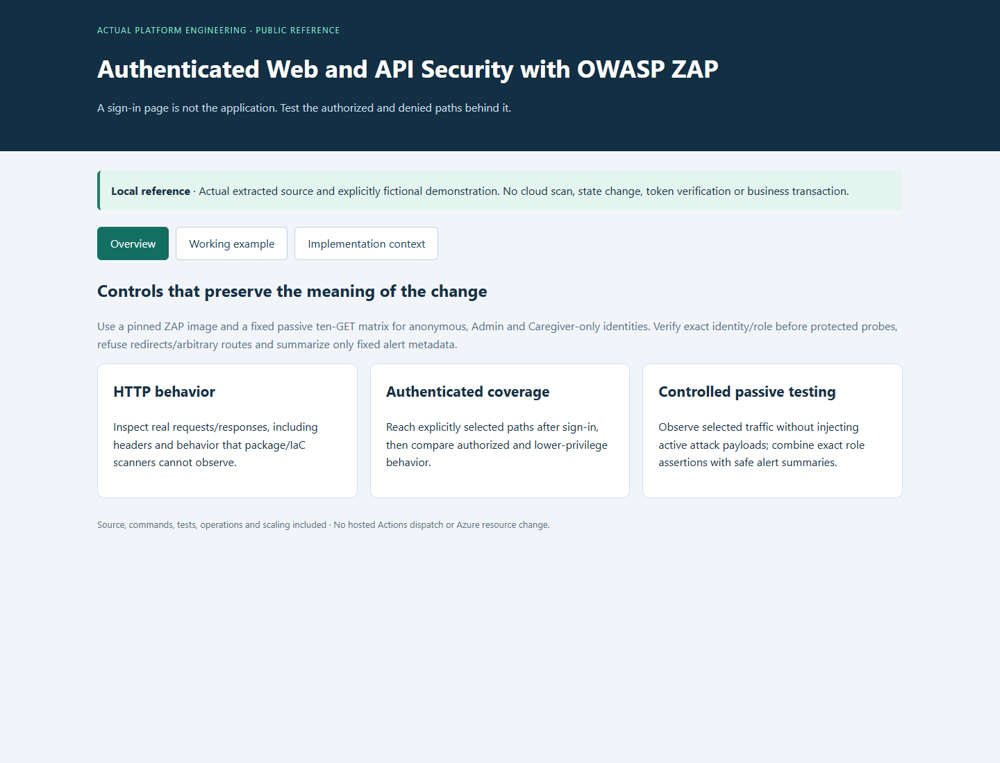
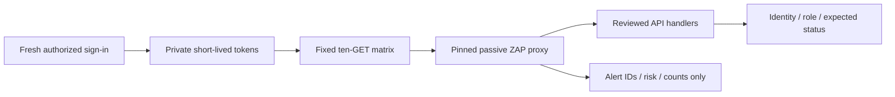
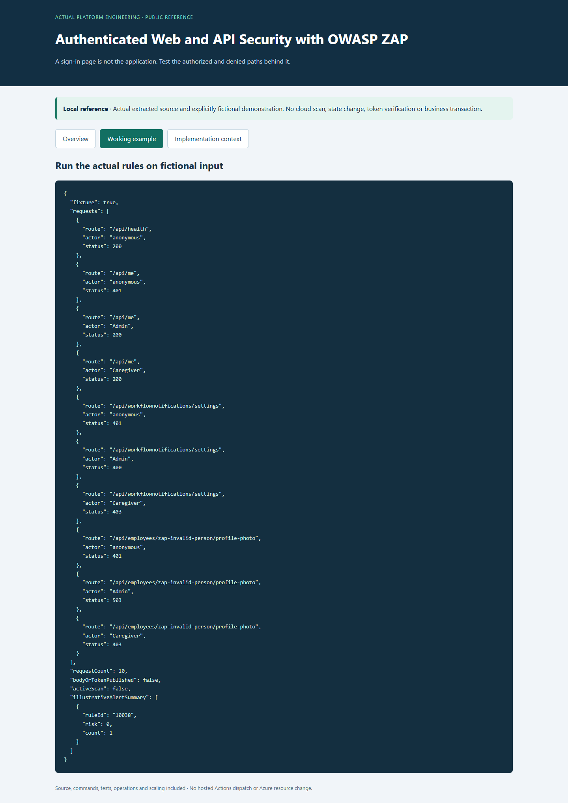

# Authenticated Web and API Security with OWASP ZAP

**Check what users can reach after sign-in, including what lower-access accounts must be denied.**

[Business problem](#the-business-problem) · [Solution](#the-solution) · [Strengths](#engineering-strengths) · [Proof](#proof-it-works) · [Commands](docs/COMMANDS.md)



## The Business Problem

A security scan of the sign-in page can miss the application behind it. The platform needed checks of selected staff-only routes and clear proof that an employee account could not use them. Login tokens and private responses also needed to stay out of the reports.

## The Solution

Use OWASP ZAP to inspect a small, fixed set of read-only web requests. Confirm the signed-in accounts and roles, compare the expected allowed and denied responses, and report only safe summary information. This test observes traffic without sending active attack requests.

**Business outcome:** The recorded test covered ten read-only requests across four server handlers. It found two informational cache observations and no Low, Medium or High alerts in that limited sample; it did not clear the whole application.

## Engineering Strengths

| Strength | Practical value |
| --- | --- |
| **HTTP behavior** | Inspect real requests/responses, including headers and behavior that package/IaC scanners cannot observe. |
| **Authenticated coverage** | Reach explicitly selected paths after sign-in, then compare authorized and lower-privilege behavior. |
| **Controlled passive testing** | Observe selected traffic without injecting active attack payloads; combine exact role assertions with safe alert summaries. |

## Architecture



This project is derived from actual workforce-platform implementation. Identifying labels/targets use examples. The local viewer and demonstration are new reference code; [source mapping](docs/SOURCE-MAP.md) identifies the copied/extracted files and limitations.

## What Was Built

| Component | Purpose | Implementation |
| --- | --- | --- |
| Actual authenticated adapter | Fixed target, private token handling and alert-summary filtering | [Source](scripts/zap_authenticated.py) |
| Actual role matrix | Four allowlisted handlers and expected actor/status observations | [Source](scripts/zap_role_matrix.py) |
| Pinned ZAP image | Immutable selected scanner reference | [Pin](security/zap-lock.json) |
| Actual tests | Reject wrong identity, incorrectly structured roles, arbitrary routes and token/report leakage | [Tests](scripts/) |
| Local demonstration | Exercise actual rule/evaluation code using fictional data | [Demo](scripts/demo.py) |
| Dated context | Keep recorded implementation separate from new local evidence | [Context](data/history.json) |

## Proof It Works

### 1. Run focused checks

```bash
python -B -m unittest discover -s scripts -p 'test_*.py' -v
python -B scripts/demo.py
```

**Observed:** Nine original Python tests of the agreed input and output rules passed. The fictional probe exercises the actual ten-request evaluator. [Validation](docs/VALIDATION.md) records the exact scope and distinguishes pure/mock checks from testing with the hosted services.

### 2. Inspect the decision output



The output is explicitly fictional and exercises the included logic. A successful rule test or simulation is not a completed real-world operation. No new hosted scan, token collection or Microsoft sign-in was performed. The public target is deliberately api.workforce.invalid.

### 3. Open the reference viewer

```bash
python -B scripts/preview.py --port 8139
```

Open [the local reference](http://127.0.0.1:8139). Switch between Overview, Working example and Implementation context. Ctrl+C stops it. Screenshots are genuine local captures, not hosted application/Azure Portal screenshots.

## Passive, Active and Authenticated

Passive scanning inspects the traffic sent through ZAP. Active scanning generates attack requests and requires a separately authorized target/scope. Authentication changes which paths can be reached; it does not make every scan authenticated or give ZAP permission to test business writes.

The implemented adapter sends only a fixed set of GETs, with no spider, active scan or Microsoft-login replay. It verifies two distinct approved identities and a Caregiver-only role set before protected probes. A second Admin account cannot prove Caregiver denial. Request status assertions are code-defined checks; ZAP alert counts are separate passive observations.

The invalid query/person probes are deliberately expected to return specific Admin error statuses after authorization (400/503), while anonymous and Caregiver calls must be denied (401/403). Those Admin errors are not proof of a successful business operation. This sample does not retrieve real business records or validate every PDF/route.

[ZAP authentication documentation](https://www.zaproxy.org/docs/desktop/start/features/authentication/) describes broader authentication options. The selected platform mode uses privately supplied short-lived tokens rather than automating passwords/MFA.


## Operations, Limits and Growth

State clearly which system is being checked, who owns it and what the result actually proves. Test the cases that should be denied or rejected as well as the successful ones. Keep incomplete results clearly marked. Preserve private inputs and unrelated changes. Before expanding the design, measure what is slow or limited, review costs, and check access restrictions and recovery again. [Operations and scaling](docs/OPERATIONS-AND-SCALING.md).

## Project Guides

| Guide | Purpose |
| --- | --- |
| [Implementation](docs/IMPLEMENTATION.md) | Rules, boundaries and actual source design |
| [Commands](docs/COMMANDS.md) | Local tests, expected output and inspection |
| [Operations and scaling](docs/OPERATIONS-AND-SCALING.md) | Strengths, weaknesses, costs and growth |
| [Source map](docs/SOURCE-MAP.md) | Actual files and public adaptations |
| [Validation](docs/VALIDATION.md) | Observed local evidence and remaining integration scope |

No Azure service, business record or live state was changed. The public validation workflow is manual-only and was not dispatched, conserving hosted Actions minutes.
